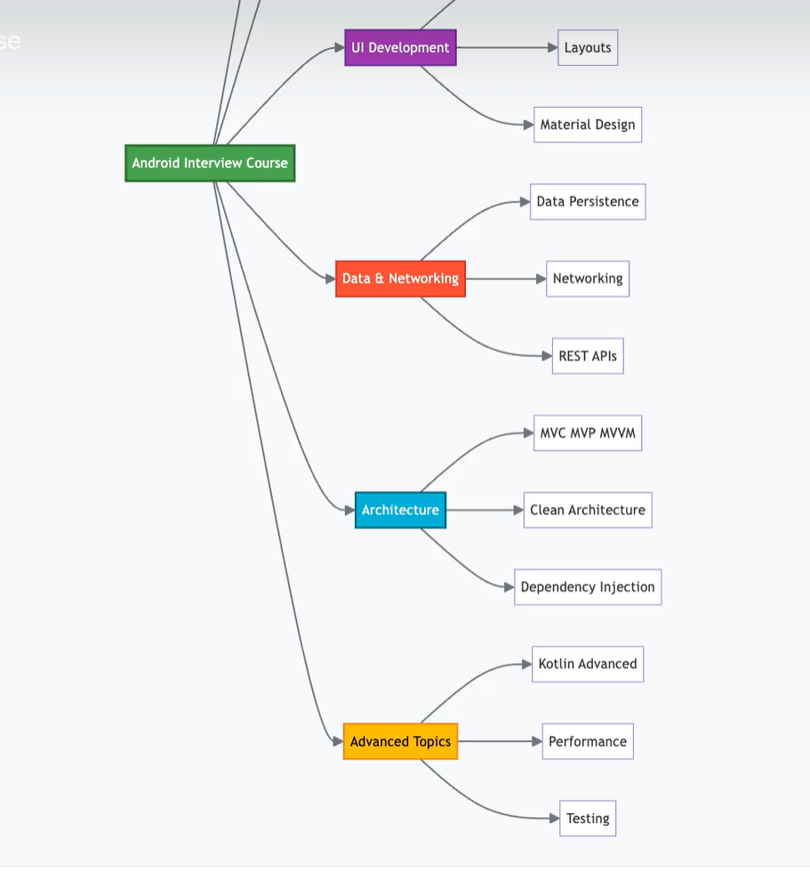
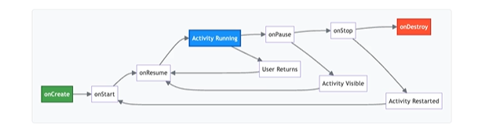
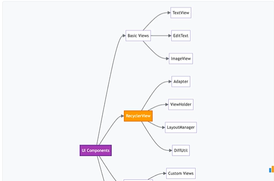
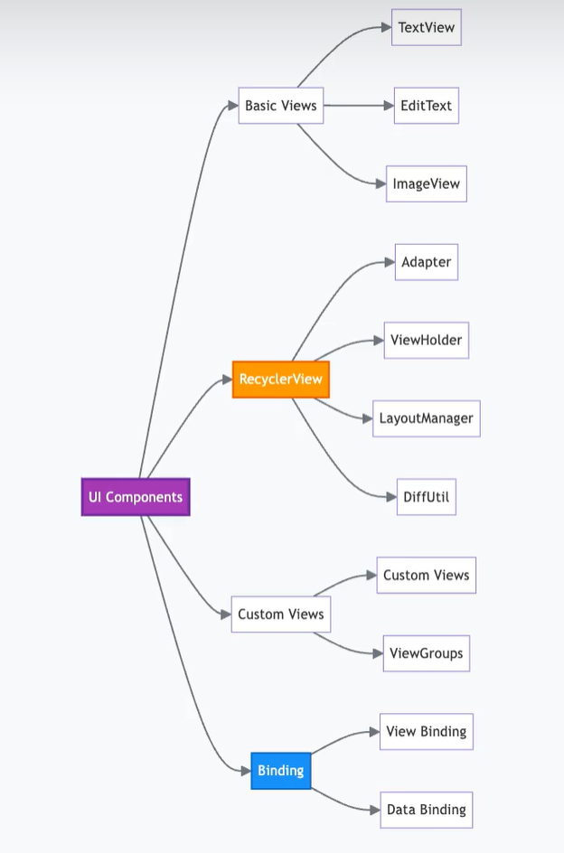
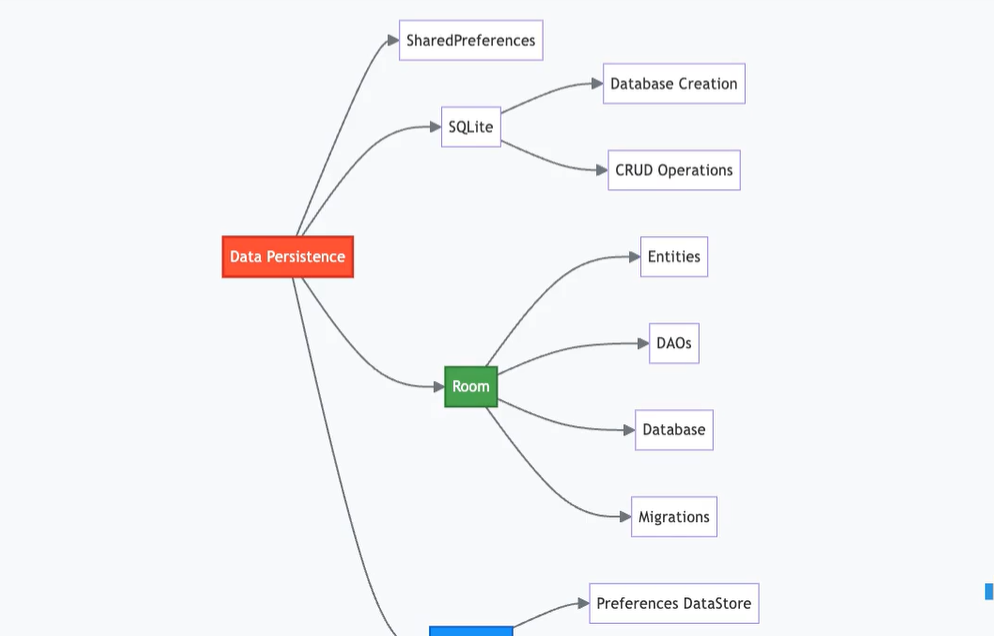
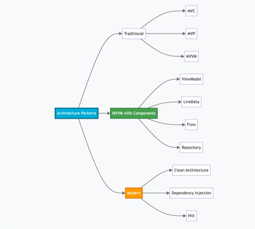
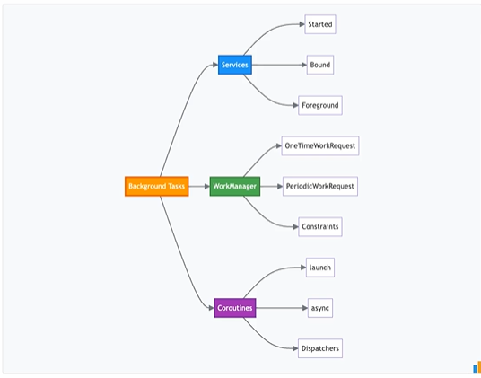
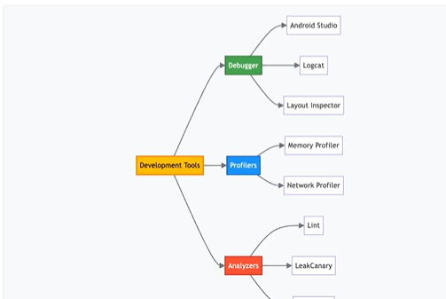

**Android Development Notes**

---

**Android Fundamentals**

* Android platform Basics

* Architecture layers, SDK, API levels

* APK structure

* Application components: Activities, Services, Broadcast Receiversm Content Providers

* Android Menifest and permissions

---

**Fragment Management and UI Components**

* Fragment management and communication

* ViewPage Integration

* UI components TextView, EditText, ImageView, RecycleView

*RecycleView Patterns: Adapters, ViewHolders, LayoutManagers, DiffUtil.

---

**Layouts and Custom Views**

* Custome views and ViewGroups

* View Binding and Data binding

* Material Design components

* Layout comparision: Linear Layouts, FrameLayouts, Constraint Layouts

* Constraint layouts advantanges: chains, guidelines barries

---

**Data preferences**

* shared preferences

* sqlite database

* Room persistence library: entities, DAOs, Migrations

* Datastore Preferences and Proto

* Networking: HTTP/HTTPS, volley, Retrofit, OkHttp

---

**Networking and Architecture Patterns**

* Retrofit setup and annotations

* Request/responses handling and interceptors

* Error Management

* Json parsing, GSON, Moshi

* Network cachiing and offline support

* Architecture patterns: MVC, MVP, MVVM

---

**MVVM and Dependency Injection**

* MVVM and Android Architecture Components

* ViewModels, LiveData, Flow, StateFlow

* Clean Architecture principles

* Repository patterns

* Dependency injection: Dagger and Hilt

---

**Kotin Language Features**

* Kotlin vs Java difference

* Null safety, data classes, sealed classes

* Extension functions

* coroutines, suspend functions

* Flow, StateFlow

* Scope functions: let, apply, run, with

---

**Memory Management and Performance**

* Android memory model

* Garbage collection

* Memory leak causes and identificaiton

* Performance optimization view hierarchy, bitmaps, ProGuard, R8

* Setup time and battery optimization

---

**Coroutines and Background tasks**

* Kotlin vs Java difference

* Null safety , data classes, sealed classes

* Extension functions

* coroutines suspend functions

* flow, stateflow

* scope functions: let, apply, run, with

---

**Broadcast Receivers and Jetpack components**

* Broadcast receivers: registration methods

* System vs custom broadcasts

* Modern restrictions

* Jetpack components: Navigation, Paging, WorkManager, Datastore, Compose

---

**Jetpack Compose and Material Design**

* Fragment management and communication

* Viewpager integration

* UI components: Texview, edittext, recycleview

* RecycleView patterns: Adapters, ViewHolders, LayoutManagers, DiffUtil

---

**Testing and Security**

* Android Memmory model

* Garbage colleciton

* Memory leak causes and identificaition

* Performance optimization view hirarchy, bitmaps, proguard,R8

* Startup and battery optimization

---

**Gradle and Debugging tools**

* Android studio debugger, logcat, laout inspector

* Memory Profiler, Network Profiler

* Lint Analysis, LeakCanary, FirebaseCrashlytics, ADB

* System Design questions: photo sharing apps, news feed apps

* offline-first and scalable architectues

---

**System Design**

* Designing caching systems

* Real-time features

* Handling large datasets

* Search Functionality

* in-app purchases and splash screen

* Data structures: LRU Cache, trees, graphs

* String Manipulations

* Android Challenges: customViews, RecycleView, Retrofit, Room

* Navigation: bottom nav, drawers

* Customer animations

* Digital vs DialogFragment

---

